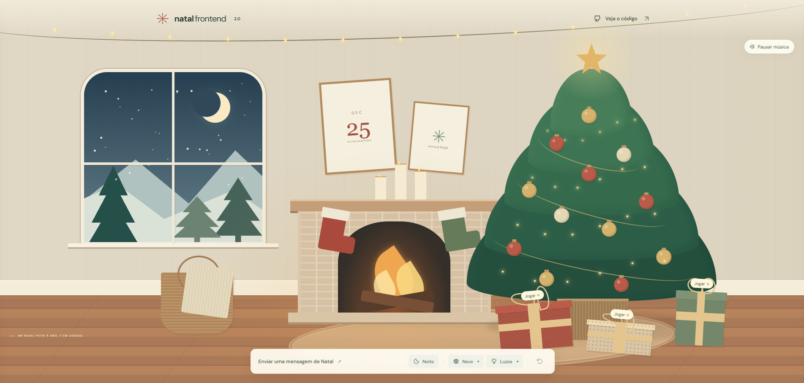

<div align="center">

# 🎄 Natal Frontend 2.0

**Um pouco de magia. Feita de código.**

Um cenário natalino interativo para explorar, brincar e enviar carinho em forma de mensagem.

React · TypeScript · Vite · CSS · Web Audio API

[A primeira versão](https://denysonsoares.github.io/natal-frontend/) · [Como executar](#como-executar) · [Publicação](#publicação-na-vercel)

</div>

## Sobre o projeto

O Natal Frontend começou como um cenário desenhado com HTML e CSS. A versão 2.0
preserva essa ideia e acrescenta componentes React, animações, uma trilha
instrumental, cartões compartilháveis e pequenas surpresas escondidas na sala.

O cenário ocupa a primeira tela da página. Abaixo dele, o visitante pode criar
uma mensagem de Natal e compartilhar o link com alguém especial.

### Prévia do cenário



*Cenário principal em tela cheia, com os controles de ambiente, música e acesso aos cartões de Natal.*

## O que você encontra

- **Sala desenhada com CSS:** árvore decorada, janela, lareira, presentes e piso de madeira.
- **Controles do ambiente:** dia e noite, neve e iluminação. Ao apagar as luzes, o brilho da lareira permanece.
- **Música natalina:** instrumental sintetizado no navegador, com botão para pausar e retomar.
- **Jogo dos presentes:** acompanhe o embaralhamento e encontre a estrela entre três caixas.
- **Cartões personalizados:** nome do remetente e mensagem em um link compartilhável.
- **Contribuição voluntária:** QR Code e Pix Copia e Cola com valor escolhido pelo doador.
- **Layout responsivo:** adaptações para telas menores e respeito à preferência de movimento reduzido.

<details>
<summary>✨ Descubra os easter eggs (contém spoilers)</summary>

- **Lua:** à noite, clique nela para ver o trenó do Papai Noel atravessar a janela.
- **Estrela da árvore:** clique cinco vezes para revelar a estrebaria onde Jesus nasceu. Use o botão da cena para voltar à sala.
- **Três acertos seguidos:** no jogo dos presentes, descubra uma festa secreta. Errar ou abandonar uma rodada em andamento zera a sequência.

</details>

## Como executar

Requer **Node.js 22.12+** e npm.

```bash
git clone https://github.com/DenysonSoares/natal-frontend-2.0.git
cd natal-frontend-2.0
npm ci
npm run dev
```

Abra o endereço informado pelo Vite no terminal. Não é necessário configurar
banco de dados, autenticação, API ou variáveis de ambiente.

### Comandos disponíveis

| Comando | Função |
| --- | --- |
| `npm run dev` | Inicia o servidor de desenvolvimento. |
| `npm run build` | Verifica o TypeScript e gera o build em `dist/`. |
| `npm run preview` | Serve o build localmente para conferência. |

Para conferir a versão de produção no computador:

```bash
npm run build
npm run preview
```

O comando `preview` é destinado à verificação local, não à hospedagem em produção.

## Como funcionam os cartões

1. Preencha seu nome e uma mensagem de até 800 caracteres.
2. Gere o cartão e copie o link.
3. Compartilhe pelo aplicativo de sua preferência.
4. Quem receber verá um convite para abrir o presente e ler a mensagem.

Nome, mensagem e identificador do cartão são codificados em UTF-8/Base64URL no
fragmento `#cartao=...` da URL. Como o conteúdo está no próprio link, não há
necessidade de armazenar cartões em um servidor. Mensagens maiores geram links maiores.

A leitura é registrada no `localStorage` somente ao clicar em **Abrir meu
presente**. Depois de fechar a mensagem ou recarregar a página, o cartão aparece
como já aberto naquele navegador.

**Esse mecanismo não garante uso único global:** outro navegador, outra origem
ou a limpeza dos dados locais permite abrir novamente. Se o armazenamento
estiver bloqueado, a mensagem continua disponível com um aviso.

A codificação **não é criptografia**. Quem tiver o link pode ler ou modificar
seu conteúdo. As mensagens são renderizadas como texto. Para enviar a outras
pessoas, gere os links no site publicado; endereços `localhost` só funcionam no
próprio dispositivo.

## Música e animações

A trilha instrumental é uma composição em loop gerada localmente pela Web Audio
API, com sons suaves de sinos e acompanhamento. Não depende de downloads de áudio.

O site tenta iniciar a música ao carregar. Quando o navegador bloqueia a
reprodução automática, o início acontece após a primeira interação. O controle
fixo permite pausar e retomar a trilha.

As animações respeitam `prefers-reduced-motion`. A cena da estrebaria utiliza
uma ilustração local; o restante da sala é construído principalmente com CSS.
As fontes são carregadas pelo Google Fonts, com fontes alternativas do sistema.

## Pix opcional

A opção de apoiar o projeto aparece **depois de gerar o cartão**, sem bloquear
o compartilhamento. O doador escolhe o valor no aplicativo do banco.

A configuração fica em [`src/pix.ts`](src/pix.ts):

| Campo | Uso |
| --- | --- |
| `key` | Chave Pix do recebedor. |
| `receiverName` | Nome normalizado para o BR Code, com até 25 caracteres. |
| `receiverCity` | Cidade normalizada, com até 15 caracteres. |
| `amount` | Vazio para contribuição de valor livre. |
| `bankPayload` | Opcional: código emitido pelo banco, usado no lugar do código gerado. |

O QR Code é gerado localmente com `qrcode.react`. O payload estático utiliza BR
Code e CRC16/CCITT-FALSE. Não há integração bancária ou confirmação automática
de pagamento. Ao usar um código emitido pelo banco, confira se ele também permite
valor livre. A chave configurada fica pública nos arquivos enviados ao navegador.

## Estrutura do projeto

```text
src/
├── App.tsx                 # Sala, controles e acesso ao cenário secreto
├── index.css               # Estilos e ilustração CSS da sala
├── CardExperience.tsx      # Criação, compartilhamento e abertura de cartões
├── cards.ts                # Codificação, validação e identificação dos cartões
├── GiftGame.tsx             # Jogo dos presentes e sequência de acertos
├── BackgroundMusic.tsx     # Controle da música
├── christmasMusic.ts       # Síntese e agendamento da trilha
├── MoonSurprise.tsx        # Surpresa da lua
├── NativityScene.tsx       # Cena de Belém e retorno à sala
├── PixSupport.tsx          # Interface de contribuição voluntária
├── pix.ts                  # Configuração e geração do código Pix
└── assets/                 # Imagens locais
```

## Publicação na Vercel

1. Envie o código para seu repositório no GitHub.
2. Importe o repositório como um projeto na Vercel.
3. Use as configurações abaixo e publique.

| Configuração | Valor |
| --- | --- |
| Framework | Vite |
| Diretório raiz | Raiz do repositório |
| Instalação | `npm ci` |
| Build | `npm run build` |
| Diretório de saída | `dist` |
| Node.js | 22.x ou versão compatível mais recente |
| Variáveis de ambiente | Nenhuma |

Com a integração Git habilitada, os próximos envios à branch de produção
atualizam o site. Os links dos cartões usam fragmentos de URL, sem precisar de
rotas de backend para abri-los.

Após publicar, confira o cenário no celular, a abertura de um cartão em outro
navegador, os controles de áudio e a leitura do Pix no aplicativo do banco.

## Autor

Criado por [Denyson Soares](https://github.com/DenysonSoares).

Inspirado no [Natal Frontend original](https://github.com/DenysonSoares/natal-frontend).

*Que o simples também encante.*
